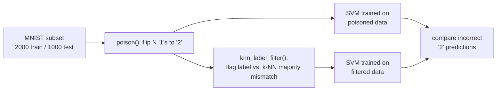

# Data Poisoning: Label-Flip Attack and a k-NN Defense

An SVM trained on MNIST barely notices if you flip a handful of "1" labels to "2" in its
training data — it just shrugs the attack off. This project starts from that observation and
asks the natural next question: if the attack is that sneaky, can it actually be caught before
it does damage? So alongside the label-flipping attack itself, there's a real defense here — a
k-NN label-consistency filter — and a close look at exactly how far it can be pushed before it
gives out.



## Why this matters

It's easy to show that an attack works. It's more useful to show where a defense against it
breaks down, because that's the part an attacker actually needs to know and a defender actually
needs to plan around. The original project proves the SVM barely reacts to 10 or 30 flipped
labels, and only really starts to wobble around 100 — but it stops there. This project keeps
going and asks whether the poisoned samples can be spotted ahead of time, and how that holds up
as the attacker gets more ambitious.

## The defense, in plain terms

For every training image, look at its 5 nearest neighbors in pixel space (excluding itself) and
see what label they mostly agree on. If an image's own label doesn't match that neighborhood
consensus, something's off — flag it and leave it out of training. The idea is simple: a "1"
that's been relabeled "2" still *looks* like a 1, so its neighbors should still mostly be real
1s. That mismatch is exactly what the filter is listening for.

## Setup

```bash
uv run python poison_defense.py
```

`uv` keeps everything in a project-local virtual environment (see
[`pyproject.toml`](./pyproject.toml)), so there's nothing to clean up afterward beyond deleting
the folder.

## Results

With no poisoning at all, the SVM reaches **88.70%** test accuracy and still makes **12**
incorrect "2" predictions on its own — a useful reminder that not every misclassified "2" is the
attack's fault.

| Poisoned ('1'→'2') | Incorrect '2's, no defense | Incorrect '2's, defended | Poisoned samples caught | Clean samples false-flagged | Accuracy, defended |
|---|---|---|---|---|---|
| 10  | 15 | 11 | 10/10 (100%) | 187 | 89.20% |
| 30  | 28 | 17 | 26/30 (87%)  | 197 | 89.20% |
| 100 | 66 | 60 | 53/100 (53%) | 226 | 85.10% |

(Full run output in [`run_output.txt`](./run_output.txt).)

### What actually happens here

- **At 10 and 30 poisoned samples, the defense earns its keep.** It caught every poisoned sample
  at the 10-sample level and most of them at 30, and the cleaned-up model actually came out
  slightly ahead of the untouched baseline (89.20% vs. 88.70%). Removing the poison more than
  made up for the clean samples it also swept away.
- **Push the attack to 100 samples, though, and the catch rate falls off a cliff: 100% → 87% →
  53%.** Once nearly half of the "1" training images have been flipped, a poisoned sample's
  nearest neighbors start being *other* poisoned samples instead of real 1s — the attack has
  grown dense enough to vouch for itself. That's really the headline finding here: the defense
  doesn't degrade smoothly, it has a specific breaking point tied to how crowded the poisoned
  region gets.
- **There's a steady cost to running this defense at all** — somewhere between 187 and 226 clean
  samples (roughly 9-11% of the training set) get flagged by mistake every time, poisoned or
  not. Raw pixel distance isn't a perfect similarity measure, and genuinely ambiguous digits
  (thin 7s that look like 1s, 4s that look like 9s) pay the price. That cost was worth it when
  the attack was small, but it doesn't shrink just because the attack grows — it's closer to a
  flat tax than an adaptive one.

## What this suggests for anyone actually defending against this

- **This kind of defense is really a density check, not a hard guarantee.** It works as long as
  poisoned points are still a minority in their own neighborhood. Once an attacker can afford
  enough poisoned samples to form a locally self-consistent cluster, the defense's own logic
  starts working against it. A defender leaning on this approach needs some sense of how big an
  attack they're up against.
- **Raw pixel space is the weak link.** The couple hundred false positives per run point to the
  similarity metric itself as the bottleneck — a learned embedding or even plain PCA would
  likely tell ambiguous-but-clean digits apart from poisoned ones far better than comparing raw
  784-dimensional pixel vectors.
- **Catching poison and preventing damage aren't the same thing.** At 100 poisoned samples the
  filter still caught over half of them (53/100), yet accuracy barely moved. The half it missed
  was apparently enough to do most of the harm on its own.

## Notes

- Runs locally through `uv` — no Docker, no GPU, no persistent service. This is just
  scikit-learn/numpy/pandas/matplotlib on CPU, a very different footprint than the
  Ollama-based projects elsewhere in this repo. Deleting the folder (or just `.venv/`) cleans
  up everything.
- MNIST is pulled once via `sklearn.datasets.fetch_openml` and cached locally by scikit-learn.
- `k=5` was a reasonable starting point, not a tuned one — sweeping `k` and trying a richer
  feature space are the obvious next steps if this gets extended further.

## Acknowledgments

This extends the label-flipping attack from [Sam Bowne's ML106 data-poisoning project](https://samsclass.info/129S/proj/ML106.htm),
adding the k-NN defense and the analysis of where it breaks down.
